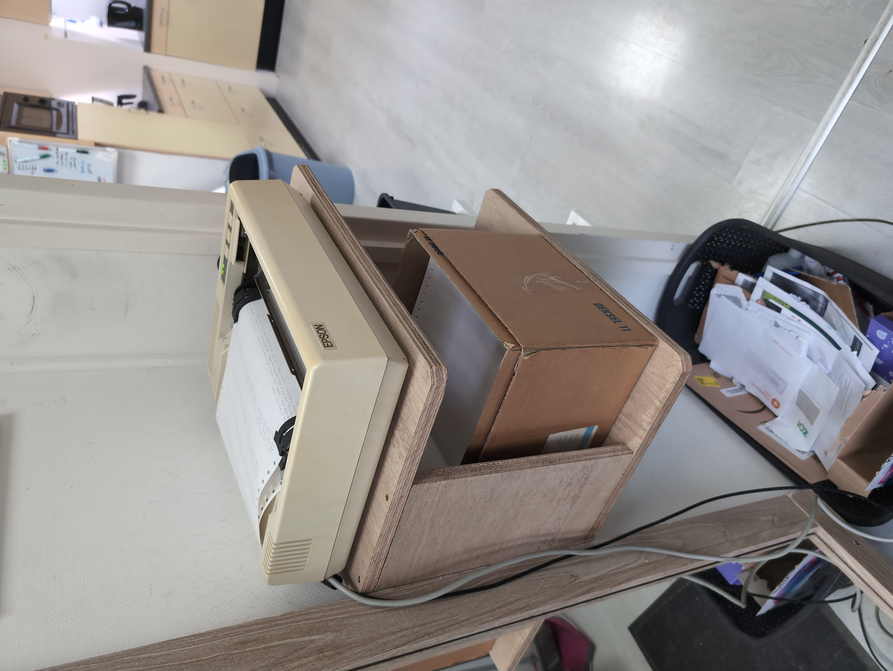
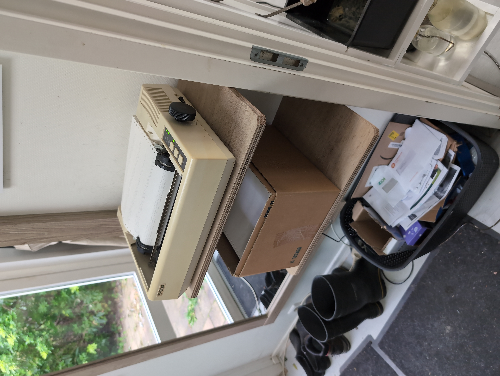
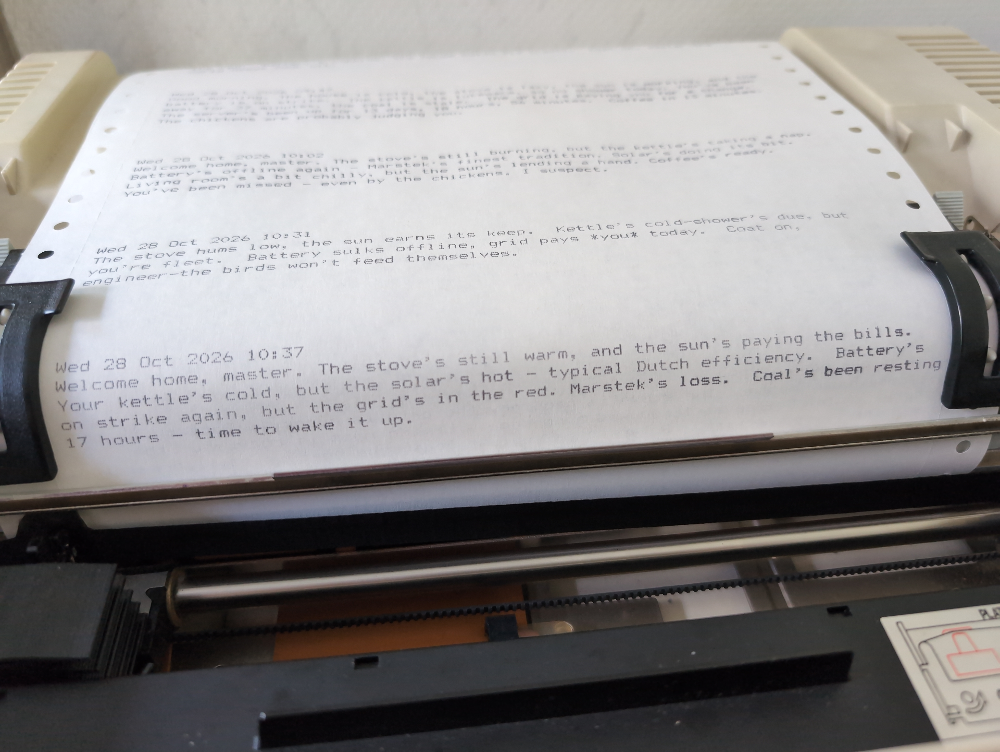

# Welcome_machine
Machine that (loudly) prints a welcome message upon your arrival home. Uses AI inspired by measurement data.

Quotes for the prompt are read from the files listed in `quotes_files` in `welcome.json` (default: `quotes.txt`, kept out of the repo). To get started, copy the included `quotes_example.txt` to `quotes.txt`.

